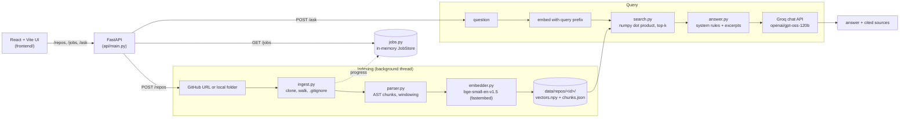

# Code Search

Ask natural-language questions about a Python repository and get a short answer that cites the exact functions and line ranges it came from.

You give it a GitHub URL or a local folder. It parses the Python code into function, method and class chunks, embeds them with a local model, and answers questions by retrieving the closest chunks and passing only those to an LLM (Groq). Every claim in an answer is tied to a `(chunk id, lines X-Y)` citation, and the model is told to refuse rather than guess when the excerpts don't cover the question.

> **Status: prototype.** Python files only, one process, in-memory job tracking, no auth, no tests yet. See [What I'd do next](#h-what-id-do-differently-with-more-time).

**Demo:** [Screen Recording 2026-11-03 at 1.32.52 AM.mov](Screen%20Recording%202026-11-03%20at%201.32.52%E2%80%AFAM.mov)

---

## a. Quick setup

**Requirements:** Python 3.13+, [uv](https://docs.astral.sh/uv/), Node 20+, `git`, and a [Groq API key](https://console.groq.com/).

```bash
# 1. Backend
cd backend
cp .env.example .env          # then set GROQ_API_KEY in backend/.env
uv sync                       # installs from uv.lock
uv run uvicorn api.main:app --reload --port 8000

# 2. Frontend (new terminal)
cd frontend
npm install
npm run dev                   # http://localhost:5173
```

Open http://localhost:5173, paste a GitHub URL (`https://github.com/owner/repo`) or a local folder path, wait for indexing to finish, then ask a question.

**Notes**

- The first indexing run downloads the embedding model (`BAAI/bge-small-en-v1.5`, about 130 MB) and caches it.
- Indexing works without a Groq key. Only `/ask` needs one; without it the API returns `503`.
- Indexed data goes to `WORKSPACE_DIR` (default `./data/repos`, which resolves to `data/repos` at the project root in the current `.env`). Each repo is stored under a hash of its source.
- `.env` is git-ignored. Never commit your key.

**Config** (`backend/.env`, read by `backend/core/config.py`)

| Variable | Default | Purpose |
| --- | --- | --- |
| `GROQ_API_KEY` | `""` | Required for `/ask` |
| `WORKSPACE_DIR` | `./data/repos` | Where clones, vectors and chunks are written |
| `MAX_INDEX_WORKERS` | `2` | Declared in `.env` but not read by any code yet |

Other settings (`groq_model`, `max_file_bytes`, `supported_extensions`, `clone_timeout_s`) are defined in `config.py`.

**API**

| Method | Path | What it does |
| --- | --- | --- |
| `GET` | `/health` | Liveness check |
| `POST` | `/repos` | Start indexing `{"source": ...}`. Returns `202 {"job_id"}`. Reuses a running job for the same source |
| `GET` | `/jobs/{job_id}` | Job status, progress, log events, and `result` when done |
| `GET` | `/repos/{repo_id}/search?q=...&k=5` | Top-k chunks by cosine similarity. No LLM call |
| `POST` | `/repos/{repo_id}/ask` | Retrieve top 5 chunks, then answer with the LLM |

---

## b. Architecture overview



**Layers**

- `backend/core/ingest.py`: turns a GitHub URL or folder into a local directory. Clones with `--depth 1`, skips `.git`, `.venv`, `node_modules` and similar, and honours `.gitignore`.
- `backend/core/parser.py`: uses Python's `ast` to make one chunk per function, method and class. A class also gets a skeleton chunk with its method signatures. Chunks longer than 150 lines are split into overlapping 60-line windows. Files that don't parse fall back to plain-text windows.
- `backend/core/embedder.py`: local embeddings via `fastembed`. Vectors are L2-normalised so cosine similarity is a dot product.
- `backend/core/indexer.py`: runs the pipeline and reports progress. Writes `vectors.npy` before `chunks.json`, so a repo counts as indexed only when `chunks.json` exists.
- `backend/core/search.py`: loads the matrix and does brute-force top-k with numpy. Queries get the bge retrieval prefix.
- `backend/core/answer.py`: builds the prompt from the top 5 excerpts and calls Groq. Returns the answer, `finish_reason` and sources.
- `backend/core/jobs.py`: thread-safe in-memory job store that the UI polls.
- `frontend/`: React 19 + Tailwind v4. Dev server proxies `/repos`, `/jobs`, `/health` to `localhost:8000`, so there is no CORS setup.

---

## c. Productionizing and deploying at scale

The current design works for one user on one machine. Here's what I'd change, in order.

**1. Make indexing a queue, not a thread**
- Replace the daemon thread with a job queue (SQS + Lambda or ECS worker; Cloud Tasks + Cloud Run jobs on GCP; Service Bus on Azure; Queues on Cloudflare).
- Store job state in a database (DynamoDB, Firestore, Cosmos DB, or D1) rather than `JobStore`. Jobs should survive restarts and be visible to every API replica.
- Keep indexing and API in separate services so a 10-minute clone can't block requests or get killed by a deploy.

**2. Replace local disk with object and vector storage**
- Clones and raw chunks: S3 / GCS / R2 (`chunks.json` as objects, keyed by `repo_id` plus commit SHA).
- Vectors: today a numpy matrix per repo. For many repos use a managed vector index: OpenSearch k-NN or pgvector on Aurora/Cloud SQL, Vertex AI Vector Search, Azure AI Search, or Cloudflare Vectorize. Store a `repo_id` filter on every vector.
- Key the index on the commit SHA. Right now re-indexing a URL re-clones and overwrites.

**3. Make the embedding and LLM calls scale**
- Move embeddings to a GPU or serverless inference endpoint (SageMaker, Vertex endpoints, Azure ML) or a hosted embedding API. `fastembed` on CPU is fine for a prototype, not for many concurrent indexers.
- Batch embedding requests and add retries with backoff for LLM provider rate limits.
- Add a response cache keyed by `(repo_id, normalised question)`.

**4. Security**
- Authentication and per-tenant authorisation. Private repos need a GitHub App or token flow, stored in Secrets Manager / Secret Manager / Key Vault. Never in `.env` in production.
- Validate and allow-list Git sources. Clones run outside the sandbox, so restrict hosts and enforce size and time limits.
- Rate limiting at the edge (API Gateway, Cloud Armor, Azure Front Door, Cloudflare WAF).
- Prompt-injection hardening: repository content is untrusted input to the LLM. See the guardrails section below.

**5. Operations**
- Structured logs, traces and metrics (OpenTelemetry to CloudWatch, Cloud Trace or Azure Monitor). Track per-stage indexing time, retrieval latency, LLM latency, token counts and cost per query.
- Health checks, alerts on failed jobs, and a dead-letter queue.
- Infrastructure as code (Terraform or CDK), CI with tests and linting, containers built once and promoted through environments.

**Suggested AWS shape**

- **Frontend:** S3 + CloudFront (or Amplify).
- **API:** ECS Fargate or App Runner behind an ALB, or API Gateway + Lambda for the query path.
- **Indexing:** SQS + ECS Fargate tasks (or Batch) writing to S3.
- **Vectors:** OpenSearch Serverless (vector collection) or pgvector on Aurora Serverless v2.
- **Jobs and metadata:** DynamoDB.
- **Secrets and keys:** Secrets Manager; the Groq key or a Bedrock model if you want to stay inside AWS.

**Equivalents:** GCP (Cloud Run, Cloud Tasks, GCS, Vertex Vector Search, Firestore); Azure (Container Apps, Service Bus, Blob, AI Search, Cosmos DB); Cloudflare (Workers, Queues, R2, Vectorize, D1, Workers AI for embeddings).

---

## d. RAG / LLM approach and decisions

**Pipeline:** AST chunking → embed (bge-small-en-v1.5) → cosine top-k (k=5) → single LLM call with cited excerpts → answer.

| Decision | Options considered | Choice | Why |
| --- | --- | --- | --- |
| **Chunking** | Fixed-size characters; sliding lines; AST-based | AST-based: one chunk per function/method, class skeleton, and overlapping windows only for long bodies | Code has structure, and a function is usually the unit a question is about. Citations then map to real symbols, not random line ranges. |
| **Embedding model** | OpenAI `text-embedding-3-*`; Voyage code models; bge-base/large; bge-small | `BAAI/bge-small-en-v1.5` via fastembed (local, ONNX) | No extra API key or cost, small enough to run on a laptop, and good enough for a prototype. I haven't benchmarked it against code-specific models, so retrieval quality is unmeasured. |
| **Vector store** | Pinecone; Chroma; pgvector; Qdrant; plain numpy | Plain numpy matrix on disk, brute-force cosine | Exact search over a single repo's chunks is fast enough that an index adds nothing yet (I haven't timed it on large repos). Adds no infrastructure. Replace with pgvector or OpenSearch once there are many repos. |
| **LLM** | Anthropic / OpenAI / Bedrock; Groq; local Ollama | Groq, `openai/gpt-oss-120b` | Fast inference and a free tier for prototyping. The client is isolated in `answer.py`, so the provider can be swapped. |
| **Orchestration** | LangChain / LlamaIndex; hand-written | Hand-written pipeline in `search.py` and `answer.py` | The flow is linear (retrieve, prompt, call). A framework would add abstraction without adding behaviour I need, and would make the prompt and retrieval harder to inspect. |
| **Retrieval** | Hybrid (BM25 + dense); reranker; HyDE; multi-query | Dense only, with the file path and qualified name prepended to the embedded text | Names and paths carry a lot of signal in code. Prepending them helps queries like "login in auth". Reranking and hybrid search are the first upgrades I'd test. |

**Prompt and context management**

- The system prompt limits answers to 4 sentences, requires `(id, lines X-Y)` citations after each claim, and forces an exact refusal string when excerpts don't answer the question. Forbidding outside knowledge reduces hallucination, but doesn't eliminate it.
- Each excerpt is wrapped in `<excerpt id lines>` tags so the model can tell code from instructions and cite accurately.
- Context is fixed at five chunks, capped at 150 lines each. This keeps cost and latency predictable but has no token budget check, so a question that hits five long chunks could exceed the window. A token budget is a near-term fix.
- `max_completion_tokens=2000` and `finish_reason` are returned so truncated answers are visible to the caller.

**Guardrails**

- The LLM is only called for a repo that is indexed, and only when `GROQ_API_KEY` is set.
- Refusal string for unanswered questions; citation format for verifiability.
- Known gaps: no check that cited ids exist in the retrieved set, no check that cited line ranges match the excerpt, no defence against instructions hidden in repo comments (prompt injection), and no output filtering.

**Quality**

- I did not build an evaluation set. The only quality checks so far are manual spot checks on a few repos.
- Planned: a golden set of 30–50 questions with expected chunks (recall@5 for retrieval) and a rubric or LLM-judge for answer faithfulness, with citation validation as a deterministic check.

**Observability**

- Currently: `traceback.print_exc()` on indexing failure, and per-stage progress events in each job.
- Missing: request latency, retrieval scores as metrics, token usage, per-answer logs, and trace IDs. Add OpenTelemetry spans for `ingest → parse → embed → search → llm`, with token counts and cost recorded on the LLM span.

---

## e. Key technical decisions and why

1. **Parse with `ast`, not regex or tree-sitter.** The project is Python-only, so the stdlib parser is exact and free of dependencies. Tree-sitter is the way to add other languages.
2. **Split at symbol boundaries.** Functions and methods are the natural unit for code questions. The class skeleton lets questions about a class's shape match without embedding every method body in one chunk.
3. **Include path and qualified name in the embedded text.** Embeddings of bare code often miss the file or class a user is thinking of.
4. **Write vectors before chunks, and treat `chunks.json` as the "indexed" marker.** A crash mid-write leaves a repo that looks un-indexed, not one with mismatched vectors and chunks.
5. **Normalise vectors once, at embed time.** Search becomes a single matrix-vector product.
6. **Run indexing in the background and poll.** Cloning and embedding take minutes; the UI shows real progress from the pipeline, not a spinner.
7. **De-duplicate jobs by source.** Clicking "index" twice doesn't start two clones into the same folder.
8. **Hash the source to get the repo ID.** Stable across restarts, and no need to store a mapping. Local paths are resolved first, so the same folder gets the same ID.
9. **Keep the LLM prompt strict and short.** Answers are meant to be checked against code, so brevity and citations matter more than fluency.
10. **Use Vite's proxy instead of CORS headers.** The browser talks to one origin, which keeps local dev simple.

---


## g. How I used AI tools

<!-- TODO: write this section in your own words. Cover which tools you used (e.g. Claude Code, Chat, Copilot), where they helped, where you overrode or rejected their output, and any prompts or workflows that worked or didn't. -->
First based on the problem statement I decided the whole structure like what are stages in the whole pipeline and the architecture. Then I started coding the basic functionalities and test it. I used Claude for debugging and writing some complex logic espeacially related to parsing the code using AST. ALso used llm to indentify best chunking strategy and utilized that.
---

## h. What I'd do differently with more time

1. **Add tests first**: parser golden tests on sample files (classes, decorators, syntax errors, long functions), and an API test that indexes a fixture repo and asks a question with a mocked LLM.
2. **Build a retrieval eval set** before changing any model or chunking, so every change has a recall number.
3. **Support more languages** with tree-sitter, keeping the chunk schema the same.
4. **Pin indexes to commit SHAs** and make re-indexing incremental: only re-embed changed files.
5. **Add a reranker or hybrid search**, and measure whether it helps.
6. **Enforce a token budget** on the prompt, and validate citations against the retrieved set.
7. **Move jobs and index metadata into a real store** so the app survives restarts and runs on more than one instance.
8. **Remove the unused `MAX_INDEX_WORKERS` setting or wire it up.**

